# Data Storage Architecture
## KKV Gold Finance & Rental Management

The application is an enterprise-grade Non-Banking Financial Company (NBFC) Gold Loan, Fixed Deposit, and Commercial Real Estate Rental Management System. This document provides precise, code-verified technical documentation of the application's data storage architecture, schemas, file handling, and security controls.

---

## 1. STORAGE OVERVIEW

The application separates structured relational/business entity records from binary file attachments:

1. **Structured Application Data** is managed through the application's unified **Primary Local Storage** model and repository layer.
2. **File Attachments (Images & PDFs)** are tracked through metadata records in Primary Local Storage, while actual binary storage and reference identifiers interface with cloud and local storage streams.
3. **Local Storage** manages runtime caches, user authentication state, system configuration, and compressed backup archives.

| Storage System | Status | What It Stores | Actual Files Stored? |
| :--- | :--- | :--- | :--- |
| **Primary Local Storage (JSON Engine)** | **ACTIVE** | All structured application data: customers, gold loan contracts, ornament items, payment receipts, general daybook ledger, fixed deposits, commercial rental complexes, shops, rent payments, expenses, staff accounts, permission matrices, sequence counters, audit logs, and file metadata references (`fileId`, `driveFileId`, `viewUrl`, `downloadUrl`, `fileSize`, `mimeType`). | **Yes** (Continuous JSON persistence on local disk) |
| **Google Drive** | **CONFIGURED / INTERFACE** | Configured cloud repository for customer KYC documents, identity proofs, and profile photos; referenced in data models via `driveFileId`, `driveFolderId`, `documentDriveIds`, and `receiptDriveIds`. File retrieval and health endpoints interface via backend proxy routes (`/api/files/health`, `/api/files/:id/view`). | **Yes** (Referenced as external cloud file vault) |
| **Local Storage Backups** | **ACTIVE** | Local storage directory (`%APPDATA%/kkv-gold-finance/data` or `./data`): user authentication records (`auth/users.json`), operational configuration (`config/settings.json`, `config/counters.json`), runtime data caches, and JSZip full system backup packages (`backups/*.zip`). | **Yes** (Configuration, authentication store, and backup archives) |

---

## 2. PRIMARY LOCAL DATA MODELS

The application defines a comprehensive schema architecture covering financial operations, inventory, rental management, security, and document metadata.

### Data Categories & Collections

| Data Category | Collection / Model | Important Fields | Purpose |
| :--- | :--- | :--- | :--- |
| **Customers** | `customers` (`CustomerModel`) | `customerId`, `name`, `phone`, `address`, `idProofType`, `idProofNumber`, `customerPhoto`, `kycDocuments`, `activeLoansCount`, `totalBorrowed`, `status` | Customer demographics, KYC verification, contact information, and relation links |
| **Gold Loans** | `loans` (`LoanModel`) | `loanNo`, `receiptBillNo`, `customerId`, `principal`, `interestRate`, `bankMode`, `items[]`, `totalGrossWeight`, `totalNetWeight`, `marketValue`, `ltv`, `status`, `nextDueDate` | Gold pledge loan contracts, ornament item specifications, interest configuration, valuation, and repayment terms |
| **Receipts** | `receipts` (`ReceiptModel`) | `receiptNo`, `loanNo`, `customerId`, `kind`, `amount`, `principalComponent`, `interestComponent`, `paymentMode`, `date`, `outstandingBefore`, `outstandingAfter` | Financial payment vouchers for interest payments, principal part-payments, loan disbursements, and closures |
| **File Attachments** | `file_attachments` (`FileAttachmentModel`) | `fileId`, `entityType`, `entityId`, `documentType`, `originalFileName`, `mimeType`, `fileSize`, `viewUrl`, `downloadUrl`, `driveFileId` | Centralized metadata registry for all uploaded images, PDFs, and KYC proofs |
| **Staff & Users** | `users` (`UserModel` / `StaffModel`) | `uid`, `staffId`, `fullName`, `email`, `role`, `passwordHash`, `isActive`, `permissions` | User authentication, staff accounts, Bcrypt password hashes, and fine-grained RBAC permissions |
| **General DayBook** | `daybook` (`DayBookModel`) | `date`, `time`, `billNo`, `particulars`, `accountHead`, `mode`, `cashIn`, `cashOut`, `bankIn`, `bankOut`, `cashBal`, `bankBal` | Dual-entry general ledger tracking daily cash and bank inflows, outflows, and running balances |
| **Fixed Deposits** | `fixed_deposits` (`FixedDepositModel`) | `fdNo`, `customerId`, `depositorName`, `phone`, `principal`, `interestRatePA`, `depositDate`, `maturityDate`, `monthlyPayout`, `status` | Fixed deposit contracts, deposit terms, interest payouts, withdrawals, and renewal records |
| **Rental Complexes** | `rental_complexes` (`RentalComplex`) | `complexId`, `complexName`, `location`, `status` | Commercial real estate complex profiles and locations |
| **Rental Shops** | `rental_shops` (`RentalShop`) | `shopId`, `complexId`, `shopNumber`, `shopName`, `tenantName`, `mobileNumber`, `monthlyRent`, `advanceAmount`, `availableAdvance`, `status` | Commercial rental units, tenancy details, monthly rent rates, and security advance tracking |
| **Rent Payments** | `rental_payments` (`RentalPayment`) | `paymentId`, `complexId`, `shopId`, `tenantName`, `paymentMonth`, `monthlyRent`, `amountReceived`, `cashAmount`, `gpayAmount`, `paymentMode`, `advanceUsed` | Tenant rent collection records, payment splits, and advance ledger adjustments |
| **Rental Expenses** | `rental_expenses` (`RentalExpense`) | `expenseId`, `complexId`, `shopId`, `expenseDate`, `category`, `expenseReason`, `expenseAmount`, `paymentMode`, `paidTo` | Property maintenance, utilities, repairs, and operational expenses |
| **Audit Trail** | `staff_audits` (`StaffAuditModel`) | `staffId`, `action`, `performedBy`, `actorEmail`, `description`, `details`, `ipAddress`, `timestamp` | Immutable audit log of administrative actions, customer modifications, and financial updates |
| **Sequence Counters** | `counters` (`CounterService`) | `customerId`, `loanSequence`, `receiptNo`, `fdNo`, `complex`, `shop`, `payment`, `expense` | Monotonic sequential number generators for official contracts and vouchers |

---

### Collection Schemas & Field Details

#### Collection: `customers` (`CustomerModel`)
* **Purpose:** Core demographic, address, KYC identity proof numbers, and document references.
* **Model File:** `backend/src/models/Customer.ts`

| Field | Type | Purpose | Example |
| :--- | :--- | :--- | :--- |
| `id` / `customerId` | `String` / `Number` | Unique sequential customer identifier | `"CUST-001"` / `1` |
| `name` / `fullName` | `String` | Customer full legal name | `"Rajesh Kumar"` |
| `phone` / `phoneNumber` | `String` | Primary 10-digit mobile number | `"9876543210"` |
| `alternatePhone` | `String` | Secondary contact phone number | `"9876543211"` |
| `email` | `String` | Customer email address | `"customer@example.com"` |
| `gender` | `String` | Customer gender (`'Male' \| 'Female' \| 'Other'`) | `"Male"` |
| `dateOfBirth` / `age` | `String` / `Number` | Date of birth (`YYYY-MM-DD`) and calculated age | `"1988-05-14"` / `38` |
| `occupation` | `String` | Customer occupation or business | `"Textile Merchant"` |
| `address` / `currentAddress` | `String` | Primary residential address | `"12/4 Gandhipuram, Salem"` |
| `permanentAddress` | `String` | Permanent residential address | `"12/4 Gandhipuram, Salem"` |
| `currentAddressDetails` | `Object` (embedded) | Structured address (`houseNo`, `pincode`, `district`, `state`) | `{ houseNo: "12/4", pincode: "636001", district: "Salem", state: "Tamil Nadu" }` |
| `currentLocation` | `Object` (embedded) | GPS coordinates & Google Maps location URL | `{ latitude: 11.6643, longitude: 78.1460, googleMapsUrl: "https://maps.google.com/?q=11.6643,78.1460" }` |
| `nominee` | `Object` (embedded) | Nominee full name, relation, phone, and KYC details | `{ name: "K. Priya", relation: "Wife", phone: "9876543212" }` |
| `guarantor` | `Object` (embedded) | Guarantor full name, relation, phone, and income | `{ name: "M. Senthil", relation: "Friend", phone: "9876543213" }` |
| `idProofType` / `idProof` | `String` | Selected ID Proof type (`Aadhaar`, `PAN`, `Voter ID`, etc.) | `"Aadhaar"` |
| `idProofNumber` / `idNumber` | `String` | Government identity document number | `"XXXX-XXXX-1234"` |
| `extraPan` | `String` | Secondary PAN card number | `"ABCDE1234F"` |
| `customerPhoto` | `Object` / `String` | Photo proxy URL and metadata reference | `{ fileId: "FILE_101", viewUrl: "/api/files/FILE_101/view" }` |
| `kycDocuments` | `Array` (embedded) | Array of uploaded KYC document references | `[{ documentType: "Aadhaar Front", fileId: "FILE_102", viewUrl: "/api/files/FILE_102/view" }]` |
| `activeLoansCount` | `Number` | Number of currently active open loans | `2` |
| `totalBorrowed` | `Number` | Cumulative total principal borrowed | `150000` |
| `status` | `String` | KYC verification status (`VERIFIED`, `PENDING`, `BLOCKED`) | `"VERIFIED"` |
| `isDeleted` | `Boolean` | Soft-deletion flag | `false` |
| `createdAt` / `updatedAt` | `String` | Record creation and modification timestamps | `"2026-09-19T14:54:30.000Z"` |

---

#### Collection: `loans` (`LoanModel`)
* **Purpose:** Gold loan contracts, pledged ornaments, valuation calculations, and due dates.
* **Model File:** `backend/src/models/Loan.ts`

| Field | Type | Purpose | Example |
| :--- | :--- | :--- | :--- |
| `id` / `loanNo` | `String` | Unique loan contract number | `"GL-101"` |
| `receiptBillNo` | `Number` | Disbursement receipt sequence number | `101` |
| `customerId` | `String` | Reference to customer (`customers.id`) | `"CUST-001"` |
| `customerName` | `String` | Customer full name snapshot | `"Rajesh Kumar"` |
| `customerPhone` | `String` | Customer contact phone snapshot | `"9876543210"` |
| `date` | `String` | Loan disbursement date (`DD-MM-YYYY`) | `"19-09-2026"` |
| `loanType` / `loanTypeId` | `String` | Loan scheme name and ID | `"Gold Loan"` / `"gold-loan"` |
| `repaymentSystem` | `String` | Repayment system | `"Monthly Interest Only"` |
| `principal` | `Number` | Total principal amount in rupees | `50000` |
| `interestRate` | `Number` | Monthly interest rate percentage | `1.5` |
| `bankMode` | `String` | Payout payment mode (`Cash`, `UPI`, `Bank Transfer`, `Split`) | `"Cash"` |
| `deductAdvanceInterest` | `Boolean` | Flag indicating advance interest was deducted | `true` |
| `advanceDays` | `Number` | Number of advance interest days | `30` |
| `advanceInterestAmount` | `Number` | Calculated advance interest amount deducted | `750` |
| `cardFee` / `cardFeeEnabled` | `Number` / `Boolean` | Documentation / card processing fee | `75` / `true` |
| `items` | `Array` (embedded) | Pledged ornament items list | `[{ item: "Gold Chain", qty: 1, purity: "22ct", grossWeight: 16.5, deductionWeight: 0.5, netWeight: 16.0 }]` |
| `totalGrossWeight` | `Number` | Total gross weight of ornaments (grams) | `16.5` |
| `totalNetWeight` | `Number` | Net gold weight after stone/enamel deduction | `16.0` |
| `marketValue` | `Number` | Assessed market valuation of pledged gold | `112000` |
| `ltv` | `Number` | Loan-To-Value percentage | `44.64` |
| `monthlyInterest` | `Number` | Monthly interest in rupees | `750` |
| `photos` | `Array` | Ornament photo URLs / references | `["/api/files/FILE_103/view"]` |
| `status` | `String` | Loan status (`ACTIVE`, `CLOSED`, `PENDING`, `OVERDUE`) | `"ACTIVE"` |
| `disbursedAmount` | `Number` | Net cash disbursed to customer | `49175` |
| `outstandingPrincipal` | `Number` | Remaining unpaid principal balance | `50000` |
| `renewalDate` / `nextDueDate` | `String` | Next interest due date (`DD-MM-YYYY`) | `"19-11-2026"` |
| `isDeleted` | `Boolean` | Soft-deletion flag | `false` |

---

#### Collection: `receipts` (`ReceiptModel`)
* **Purpose:** Financial payment ledger receipts for loan disbursements, interest collections, and closures.
* **Model File:** `backend/src/models/Receipt.ts`

| Field | Type | Purpose | Example |
| :--- | :--- | :--- | :--- |
| `id` | `String` | Unique receipt identifier | `"RCPT-1001"` |
| `receiptNo` | `Number` | Monotonic receipt sequence number | `1001` |
| `loanId` / `loanNo` | `String` | Reference to associated loan | `"GL-101"` |
| `customerId` | `String` | Reference to customer | `"CUST-001"` |
| `customerName` | `String` | Customer full name snapshot | `"Rajesh Kumar"` |
| `kind` | `String` | Transaction type | `'INTEREST PAYMENT'`, `'NEW LOAN'`, `'LOAN CLOSURE'` |
| `amount` | `Number` | Total transaction amount | `1500` |
| `principalComponent` | `Number` | Portion allocated to principal reduction | `0` |
| `interestComponent` | `Number` | Portion allocated to interest payment | `1500` |
| `paymentMode` | `String` | Payment method (`Cash`, `UPI`, `Bank`) | `"Cash"` |
| `date` | `String` | Receipt date (`DD-MM-YYYY`) | `"19-09-2026"` |
| `currentDueDate` / `nextDueDate` | `String` | Loan due date before and after payment | `"19-09-2026"` / `"19-10-2026"` |
| `outstandingBefore` / `outstandingAfter` | `Number` | Principal balance before and after payment | `50000` / `50000` |
| `processedBy` | `String` | Staff email/ID who recorded receipt | `"admin@kkvgoldfinance.com"` |

---

#### Collection: `file_attachments` (`FileAttachmentModel`)
* **Purpose:** Centralized metadata records tracking all uploaded images, PDFs, and identity proofs.
* **Model File:** `backend/src/models/FileAttachment.ts`

| Field | Type | Purpose | Example |
| :--- | :--- | :--- | :--- |
| `fileId` | `String` | Unique internal file identifier | `"FILE_1789284804123_abc123"` |
| `entityType` | `String` | Target business entity type | `"customer"`, `"loan"`, `"rental"` |
| `entityId` | `String` | Associated entity ID | `"CUST-001"` |
| `documentType` | `String` | Specific document category | `"Aadhaar Front"`, `"Customer Photo"`, `"PAN Card"` |
| `originalFileName` | `String` | Original filename on user's device | `"aadhaar_scan.pdf"` |
| `storedFileName` | `String` | Normalized storage filename | `"aadhaar_scan.pdf"` |
| `mimeType` | `String` | Validated MIME format | `"application/pdf"`, `"image/jpeg"`, `"image/png"` |
| `fileSize` | `Number` | Binary size in bytes | `452300` |
| `driveFileId` | `String` | External cloud file identifier | `"1VfN7XIIeC63bfvkmz4lh8yR_V_b6wViK"` |
| `viewUrl` | `String` | Authenticated inline proxy URL | `"/api/files/FILE_1789284804123_abc123/view"` |
| `downloadUrl` | `String` | Authenticated download proxy URL | `"/api/files/FILE_1789284804123_abc123/download"` |
| `uploadedBy` | `String` | Staff member who performed upload | `"admin@kkvgoldfinance.com"` |
| `isDeleted` | `Boolean` | Soft-deletion flag | `false` |
| `createdAt` / `updatedAt` | `String` | Upload and modification timestamps | `"2026-09-19T14:54:30.000Z"` |

---

#### Collection: `users` (`UserModel` / `StaffModel`)
* **Purpose:** Staff accounts, authentication credentials, and granular RBAC permission matrix.
* **Model File:** `backend/src/models/User.ts`

| Field | Type | Purpose | Example |
| :--- | :--- | :--- | :--- |
| `uid` / `_id` | `String` | Unique internal user ID | `"usr_1789284804000_a1b2c"` |
| `staffId` | `String` | Staff member readable code | `"STAFF-001"` |
| `fullName` | `String` | Full name | `"Branch Manager"` |
| `email` | `String` | Unique login email address | `"staff@kkvgoldfinance.com"` |
| `role` | `String` | RBAC Role (`ADMIN`, `MASTER_ADMIN`, `STAFF`, `RENTAL_STAFF`) | `"STAFF"` |
| `passwordHash` | `String` | Salted Bcrypt password hash (10 rounds) | `"$2b$10$wK1...hash..."` |
| `isActive` | `Boolean` | Account active status | `true` |
| `permissions` | `Object` (embedded) | Feature permission flags (`customers`, `loans`, `fixedDeposits`, `rental`, `viewKyc`) | `{ customers: { view: true, create: true }, viewKyc: false }` |

---

## 3. IMAGE STORAGE

The application processes customer profile photos, webcam captures, and ornament photographs using an authenticated memory-buffered pipeline.

### Image Storage Specification

| Property | Actual Implementation |
| :--- | :--- |
| **Actual File Storage** | Handled via in-memory buffer (`multer.memoryStorage()`) and dispatched to storage proxy |
| **Primary Model** | `file_attachments` (`FileAttachmentModel`) & `customers` (`CustomerModel`) |
| **Storage Fields** | `file_attachments.fileId`, `customers.customerPhoto`, `customers.customerPhotoData` |
| **Google Drive File ID** | Stored in `file_attachments.driveFileId` and `customers.customerPhotoData.driveFileId` |
| **Google Drive URL / Reference** | Stored as authenticated proxy path `viewUrl: "/api/files/:id/view"` |
| **Filename** | Stored in `file_attachments.originalFileName` and `storedFileName` |
| **MIME Type** | Stored in `file_attachments.mimeType` (`image/jpeg`, `image/png`, `image/webp`) |
| **File Size** | Stored in `file_attachments.fileSize` (in bytes) |
| **Upload Timestamp** | Stored in `file_attachments.createdAt` (ISO 8601 string) |

### Image Upload Flow

```
[USER]
  │ Takes webcam photo or selects image (JPG, PNG, WEBP)
  ▼
[REACT FRONTEND]
  │ Component: `CustomerFormModal.tsx` / `CameraCapture.tsx`
  │ Appends to FormData, sends with Authorization Bearer JWT
  ▼ POST /api/files/upload  (or POST /api/customers)
[BACKEND API ROUTER]
  │ `backend/src/routes/file.routes.ts`
  ▼
[UPLOAD MIDDLEWARE]
  │ `handleUploadMiddleware` (Multer Memory Storage)
  │ Validates file size (max 10 MB) and allowed MIME types
  ▼ In-memory Buffer created (no temp file written to disk)
[FILE CONTROLLER]
  │ `uploadFileHandler` in `backend/src/controllers/file.controller.ts`
  ▼
[PRIMARY STORAGE METADATA RECORD]
  │ `FileAttachmentModel.create()` stores:
  │ - fileId: "FILE_1789284804123_abc123"
  │ - originalFileName: "customer_photo.jpg"
  │ - mimeType: "image/jpeg"
  │ - fileSize: 245600
  │ - viewUrl: "/api/files/FILE_1789284804123_abc123/view"
  │ - downloadUrl: "/api/files/FILE_1789284804123_abc123/download"
  ▼
[RESPONSE TO FRONTEND]
  Returns file metadata object with `/api/files/:id/view` reference.
```

---

## 4. PDF STORAGE

The application handles two distinct types of PDF documents:
1. **Uploaded KYC Documents** (Aadhaar cards, PAN cards, identity proof scans).
2. **Generated Payment Vouchers** (Official A4 Loan Disbursement & Payment Receipt vouchers).

### PDF Storage Specification

| Property | Actual Implementation |
| :--- | :--- |
| **Actual File Storage** | Uploaded KYC PDFs handled via memory buffer and metadata record; Receipt PDFs generated dynamically |
| **Primary Model** | `file_attachments` (`FileAttachmentModel`) & `customers.kycDocuments[]` |
| **Storage Fields** | `file_attachments.fileId`, `customers.kycDocuments[].fileId`, `customers.kycDocuments[].url` |
| **Google Drive File ID** | Stored in `file_attachments.driveFileId` and `kycDocuments[].driveFileId` |
| **Google Drive URL / Reference** | Stored as authenticated proxy route `viewUrl: "/api/files/:id/view"` |
| **Filename** | Stored in `file_attachments.originalFileName` |
| **MIME Type** | Stored in `file_attachments.mimeType` (`application/pdf`) |
| **File Size** | Stored in `file_attachments.fileSize` (in bytes) |
| **Upload Timestamp** | Stored in `file_attachments.createdAt` (ISO 8601 string) |

### Binary Storage vs. Reference Statement

> [!IMPORTANT]
> **Primary local storage stores file references (`fileId`), URLs (`viewUrl`, `downloadUrl`), filenames, MIME types, and byte sizes. It does NOT store the actual PDF binary blobs.**  
> - **Uploaded KYC PDFs** are streamed on demand through the authenticated `/api/files/:id/view` endpoint.
> - **Payment Voucher PDFs** are generated on the fly in-memory by `ReceiptPdfService` using PDFKit upon calling `GET /api/receipts/:id/pdf` and streamed directly to the HTTP response without being written to disk.

---

## 5. LOCAL STRUCTURED STORAGE VS GOOGLE DRIVE

```
+─────────────────────────────────────────────────────────────────────────+
|                         DATA STORAGE DIVISION                           |
+─────────────────────────────────────────────────────────────────────────+
|                                                                         |
|   STRUCTURED DATA (Local Storage)      EXTERNAL FILES (Google Drive)    |
|   ┌─────────────────────────────┐      ┌─────────────────────────────┐  |
|   │ • Customer Profiles         │      │ • Customer Profile Photos   │  |
|   │ • Gold Loan Contracts       │      │ • KYC Aadhaar Card Scans    │  |
|   │ • Pledged Ornament Details  │      │ • KYC PAN Card Scans        │  |
|   │ • Payment Receipts          │      │ • Identity Proof Documents  │  |
|   │ • General DayBook Ledger    │      │ • Pledged Ornament Photos   │  |
|   │ • Fixed Deposit Records     │      └─────────────────────────────┘  |
|   │ • Rental Properties & Shops │                     ▲                 |
|   │ • Rent Payments & Expenses  │                     │                 |
|   │ • Staff Accounts & RBAC     │                     │ Referenced via  |
|   │ • Audit Trail & Logs        │                     │ file IDs / URLs |
|   │ • Sequence Counters         │                     │                 |
|   └──────────────┬──────────────┘                     │                 |
|                  │                                    │                 |
|                  ▼                                    │                 |
|   FILE METADATA REFERENCES (Local)                    │                 |
|   ┌───────────────────────────────────────────────────┴──────────────┐  |
|   │ • fileId: "FILE_1789284804123_abc123"                            │  |
|   │ • driveFileId: "1VfN7XIIeC63bfvkmz4lh8yR_V_b6wViK"               │  |
|   │ • originalFileName: "aadhaar_card_scan.pdf"                      │  |
|   │ • mimeType: "application/pdf"                                    │  |
|   │ • fileSize: 452300                                               │  |
|   │ • viewUrl: "/api/files/FILE_1789284804123_abc123/view"           │  |
|   │ • downloadUrl: "/api/files/FILE_1789284804123_abc123/download"   │  |
|   │ • uploadedAt: "2026-09-19T14:54:30.000Z"                         │  |
|   └──────────────────────────────────────────────────────────────────┘  |
|                                                                         |
+─────────────────────────────────────────────────────────────────────────+
```

### Stored Directly in Primary Local Storage
* All customer personal, demographic, contact, and relation details.
* All loan principal amounts, interest rates, penalty rules, and ornament specifications.
* All transaction amounts, payment mode splits, cash & bank running balances.
* All fixed deposit parameters, interest payout schedules, and maturity dates.
* All commercial complex and shop tenancy data, monthly rents, and expenses.
* All user accounts, hashed passwords, and permission matrices.
* All audit trail entries and sequential counter states.

### Stored as External Files
* Actual binary image files (`.jpg`, `.png`, `.webp`) of customer profile photos and webcam captures.
* Actual binary PDF/image files (`.pdf`, `.jpg`, `.png`) of KYC identity proofs (Aadhaar, PAN, Passport).

### Stored in Primary Storage as File References
* `fileId`: Internal unique key.
* `driveFileId`: Cloud reference identifier.
* `driveFolderId`: Cloud directory reference identifier.
* `originalFileName` & `storedFileName`: Document filenames.
* `mimeType`: Format identification string.
* `fileSize`: Exact byte count.
* `viewUrl` & `downloadUrl`: Application proxy streaming endpoints.
* `createdAt`: Upload timestamp.

---

## 6. FILE SIZE & STORAGE LIMITS

File sizes are enforced through validation middleware upon upload and stored as exact integer byte counts in storage metadata.

| File Type | Configured Upload Limit | Actual Size Stored in DB? | Storage Size Field | Source of Size |
| :--- | :--- | :--- | :--- | :--- |
| **Customer Photo (JPG/PNG/WEBP)** | **10 MB** (`10 * 1024 * 1024` bytes) | **Yes** (Exact bytes) | `FileAttachmentModel.fileSize`, `CustomerModel.customerPhotoData.fileSize` | Derived from `file.size` in Multer memory buffer (`uploadMiddleware.ts`) |
| **KYC Document (PDF/JPG/PNG)** | **10 MB** (`10 * 1024 * 1024` bytes) | **Yes** (Exact bytes) | `FileAttachmentModel.fileSize`, `CustomerModel.kycDocuments[].fileSize` | Derived from `file.size` in Multer memory buffer (`uploadMiddleware.ts`) |
| **Receipt Voucher PDF** | None (Dynamic) | **No** (Dynamic stream) | Not stored in DB | Computed dynamically during render (`pdfBuffer.length`, ~25 KB – 65 KB) |
| **System Backup Archive (ZIP)** | Unlimited | **Yes** (Exact bytes) | `BackupHistoryRecord.fileSize` | Derived from `zipBuffer.length` in `BackupPackageService` |

* **Validation Rules:**
  - `backend/src/middleware/uploadMiddleware.ts`: Configures Multer `limits.fileSize: 10 * 1024 * 1024`. Uploads exceeding 10 MB are rejected immediately with HTTP 400 (`LIMIT_FILE_SIZE`).
  - `backend/src/services/telegramStorage.service.ts`: Enforces `MAX_FILE_SIZE_BYTES = 10 * 1024 * 1024`. Returns HTTP 413 (`FILE_TOO_LARGE`) if violated.
* **Storage Tracking:** Total cloud quota is managed at the external cloud provider account level; Primary storage tracks individual file sizes per attachment.

---

## 7. GOOGLE DRIVE STORAGE

The application defines configuration parameters and model fields for Google Drive integration.

### Google Drive Specification

| Property | Implementation Detail |
| :--- | :--- |
| **Configuration Variables** | `GOOGLE_DRIVE_ROOT_FOLDER_ID`, `GOOGLE_CLIENT_ID`, `GOOGLE_CLIENT_SECRET`, `GOOGLE_SERVICE_ACCOUNT_EMAIL`, `GOOGLE_SERVICE_ACCOUNT_PRIVATE_KEY` (configured in `backend/src/config/env.ts`) |
| **Folder Structure** | Root folder configured by `GOOGLE_DRIVE_ROOT_FOLDER_ID`; sub-structures defined for `KYC Documents/`, `Customer Photos/`, `Receipts/`, `System Backups/` |
| **Model Fields** | `driveFileId`, `driveFolderId`, `documentDriveIds[]`, `receiptDriveIds[]`, `profilePhotoDriveId`, `kycDocumentDriveIds[]` |
| **MIME Types Handled** | `image/jpeg`, `image/png`, `image/webp`, `application/pdf` |
| **API Endpoints** | Health check routed via `GET /api/files/health` (aliased in `file.controller.ts:650` as `checkDriveHealthHandler`) |
| **Client Handling** | `src/components/common/AuthenticatedImage.tsx` detects direct Drive URLs (`drive.google.com`) or routes through authenticated backend proxy |

| File Type | Actual File Stored in Drive? | Primary Storage Reference | Drive ID Field | URL Stored? |
| :--- | :--- | :--- | :--- | :--- |
| **Customer Photo** | Configured cloud destination | `CustomerModel.customerPhotoData` | `driveFileId` | Yes (`viewUrl` proxy path) |
| **KYC Document (PDF/JPG)** | Configured cloud destination | `CustomerModel.kycDocuments[]` | `driveFileId` | Yes (`viewUrl` proxy path) |
| **Payment Receipt** | Generated dynamically on request | `ReceiptModel` | `driveFileId` (legacy) | Generated via `/api/receipts/:id/pdf` |

---

## 8. FILE RETRIEVAL

File access is protected by JWT authentication and Role-Based Access Control (RBAC). Files are never served via unprotected public URLs.

```
[FRONTEND CLIENT]
  │ Component: `AuthenticatedImage.tsx` or Document Viewer
  │ Sends HTTP GET with Header `Authorization: Bearer <JWT>`
  ▼ GET /api/files/:id/view  (or /api/files/:id/download)
[EXPRESS AUTH MIDDLEWARE]
  │ `authenticateUser` validates JWT token signature and expiration
  │ `hasPermission` verifies RBAC permissions (`viewKyc` check for identity docs)
  ▼
[FILE CONTROLLER]
  │ `viewFileHandler` in `backend/src/controllers/file.controller.ts`
  │ 1. Queries `FileAttachmentModel.findOne({ fileId: targetId })`
  │ 2. Extracts file metadata (`originalFileName`, `mimeType`, `fileSize`)
  ▼
[STREAMING PROXY]
  │ Streams binary buffer to HTTP response
  │ Sets response headers:
  │ - Content-Type: <mimeType> (e.g. application/pdf, image/jpeg)
  │ - Content-Disposition: inline; filename="<originalFileName>"
  │ - Cache-Control: private, no-cache, no-store, must-revalidate
  │ - X-Content-Type-Options: nosniff
  ▼
[CLIENT DISPLAY]
  Browser renders image/PDF inline or triggers download.
```

---

## 9. FILE DELETION & RETENTION

| Action | Primary Storage Behavior | External Storage Behavior |
| :--- | :--- | :--- |
| **Record Soft-Deleted** | Sets `isDeleted: true`, `deletedAt: new Date()`, `deletedBy: user`. Record excluded from active queries. | File binary remains in external storage; metadata preserved for audit history. |
| **Record Hard-Deleted (Admin)** | Record permanently removed from local database storage. | File deletion request dispatched to remove binary from external storage. |
| **File Attachment Deleted** | `FileAttachmentModel` updated with `isDeleted: true` via `DELETE /api/files/:id`. | File deletion handler dispatched to purge external file reference. |
| **Customer Cascade Deleted** | Permanent customer deletion cascades to remove associated loans, receipts, and attachment references. | Cascade deletion dispatches removal of associated document files. |

* **Orphan File Handling:** If a parent customer document is hard-deleted without calling the attachment purge routine, the external file may remain referenced only by its direct ID.
* **Automated Cleanup:** Scheduled background tasks manage state synchronization and snapshot creation.

---

## 10. LOCAL FILE STORAGE

Local storage is utilized for system configuration, user credentials, runtime cache mirrors, and full backup packages.

| Path | Purpose | File Types | Persistent? | Cleanup Behavior |
| :--- | :--- | :--- | :--- | :--- |
| `<StorageBaseDir>/auth/users.json` | Staff and admin account credentials with Bcrypt password hashes | `.json` | **Yes** | Updated atomically on user create/edit |
| `<StorageBaseDir>/config/settings.json` | Purity rates, interest profiles, and company profile | `.json` | **Yes** | Updated when admin modifies settings |
| `<StorageBaseDir>/config/counters.json` | Persistent sequence numbers for loans, receipts, FDs | `.json` | **Yes** | Updated on each sequential transaction |
| `<StorageBaseDir>/backups/*.zip` | Standalone full system JSZip backup packages with SHA-256 integrity manifests | `.zip`, `.json` | **Yes** | Retained until manual deletion or system wipe |
| `<StorageBaseDir>/uploads/` | Local file storage directory fallback | `.jpg`, `.png`, `.pdf` | **Yes** | Removed when `deleteFile()` is invoked |

> [!NOTE]
> User uploads processed via API routes utilize in-memory buffer handling (`multer.memoryStorage()`) during transit, preventing unmanaged temporary files from accumulating on the host disk.

---

## 11. STORAGE SECURITY & PRIVACY

1. **Authentication & Authorization:**  
   All file viewing and downloading endpoints (`/api/files/:id/view`, `/api/files/:id/download`) require a valid JWT Bearer Token. Unauthenticated requests are rejected with HTTP 401 (`AUTHENTICATION_REQUIRED`).
2. **Fine-Grained RBAC & KYC Scoping:**  
   Access to sensitive customer identity proofs (Aadhaar, PAN, Passport) is strictly gated by the `viewKyc` permission flag (`file.controller.ts:235-243`). Non-admin staff without `viewKyc` permission receive HTTP 403 (`FORBIDDEN`).
3. **Branch-Level Data Isolation:**  
   Branch operators are restricted from accessing customer files belonging to other branches (`file.controller.ts:259-266`).
4. **Credential Security:**  
   User passwords are encrypted using **Bcrypt with 10 salt rounds**. Password hashes are automatically stripped from all JSON responses (`delete copy.passwordHash`).
5. **No Direct Public URLs:**  
   Raw cloud URLs and direct storage keys are never exposed in frontend templates. The frontend accesses files exclusively through the backend proxy URL `/api/files/:id/view`.

---

## 12. STORAGE ARCHITECTURE DIAGRAM

```mermaid
flowchart TD
    subgraph Client_Layer["Client Presentation Layer (React 18 / Electron)"]
        UI["React Desktop / Web UI\n(Vite + TypeScript + Lucide)"]
        CamUpload["CameraCapture / FileUpload\n(JPG / PNG / WEBP / PDF, Max 10MB)"]
        AuthImg["AuthenticatedImage / DocViewer\n(Bearer JWT Proxy)"]
    end

    subgraph API_Layer["Backend Application Layer (Node.js / Express)"]
        Router["Express REST Router\n(/api/customers, /api/loans, /api/files)"]
        AuthMiddleware["Auth & RBAC Middleware\n(JWT Verification & viewKyc check)"]
        UploadMiddleware["handleUploadMiddleware\n(Multer memoryStorage, 10MB limit)"]
        PDFKitEngine["ReceiptPdfService\n(Dynamic In-Memory A4 Voucher Generator)"]
    end

    subgraph Model_Layer["Primary Local Storage & Model Layer"]
        CustModel["CustomerModel\n(customers collection)"]
        LoanModel["LoanModel\n(loans collection)"]
        RcptModel["ReceiptModel\n(receipts collection)"]
        AttModel["FileAttachmentModel\n(file_attachments collection)"]
        UserModel["UserModel\n(users collection)"]
        DayBookModel["DayBookModel\n(daybook collection)"]
        FDModel["FixedDepositModel\n(fixed_deposits suite)"]
        RentalModel["RentalRepository\n(commercial complexes & shops)"]
        AuditModel["StaffAuditModel\n(staff_audits collection)"]
        CounterSvc["CounterService\n(counters collection)"]
    end

    subgraph External_Storage["External File Storage"]
        DriveCloud["Google Drive / Cloud File Vault\n(Customer Photos & KYC PDFs)"]
    end

    subgraph Local_Storage["Local Storage (%APPDATA%/kkv-gold-finance/data)"]
        AuthStore["/auth/users.json\n(Bcrypt Password Hashes)"]
        ConfigStore["/config/*.json\n(Settings, Rates, Counters)"]
        BackupStore["/backups/*.zip\n(JSZip Encrypted Archives)"]
    end

    %% Upload Flow
    CamUpload -->|Multipart FormData| UploadMiddleware
    UploadMiddleware --> Router
    Router --> AuthMiddleware
    AuthMiddleware --> AttModel
    AttModel -->|Binary Upload Stream| DriveCloud
    DriveCloud -->|driveFileId & Metadata| AttModel
    AttModel --> CustModel

    %% CRUD Data Flow
    UI -->|JSON REST Requests| Router
    Router --> CustModel
    Router --> LoanModel
    Router --> RcptModel
    Router --> UserModel
    Router --> DayBookModel
    Router --> FDModel
    Router --> RentalModel
    Router --> AuditModel
    Router --> CounterSvc

    %% Retrieval Flow
    AuthImg -->|GET /api/files/:id/view| Router
    Router --> AuthMiddleware
    AuthMiddleware --> AttModel
    AttModel -->|Resolve driveFileId / Stream| DriveCloud
    DriveCloud -->|Binary Stream via Proxy| AuthImg

    %% PDF Generation Flow
    UI -->|GET /api/receipts/:id/pdf| Router
    Router --> PDFKitEngine
    PDFKitEngine -->|Dynamic A4 PDF Stream| UI

    %% Local Storage Links
    UserModel <--> AuthStore
    Router <--> ConfigStore
    Router <--> BackupStore
```


